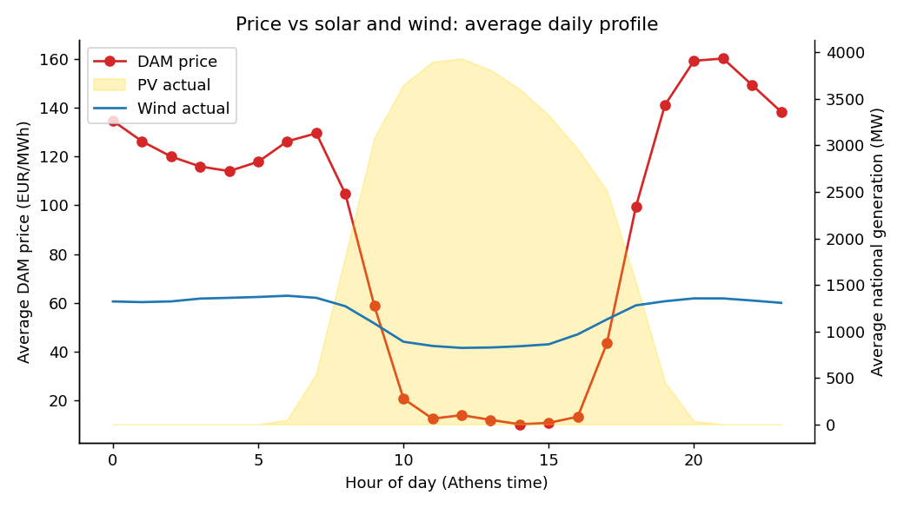
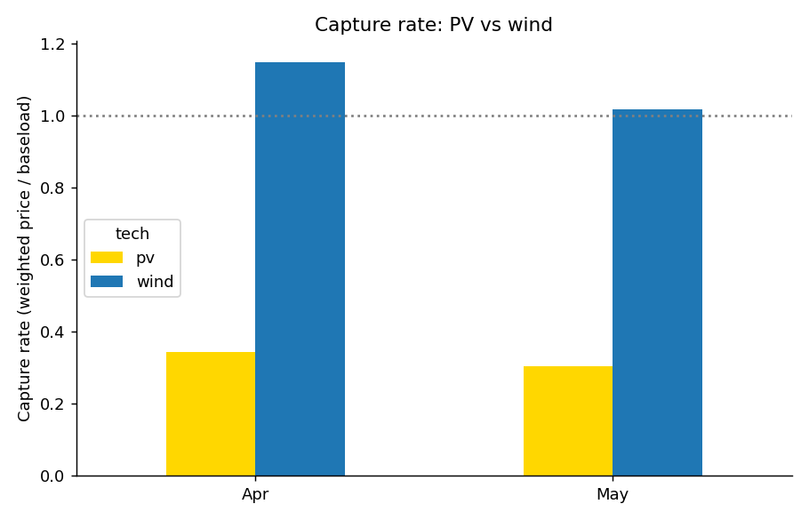
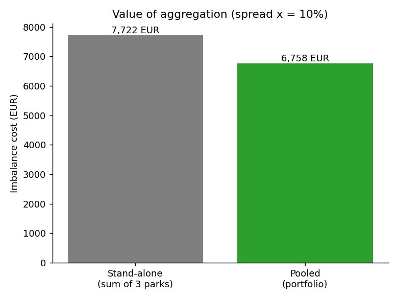

# Φορέας Σωρευτικής Εκπροσώπησης (ΦοΣΕ): χαρτοφυλάκιο 3 πάρκων ΑΠΕ στη Day-Ahead αγορά

Mini-project ανάλυσης δεδομένων αγοράς ηλεκτρικής ενέργειας (Python + SQL), που προσομοιώνει τη δουλειά ενός
ΦοΣΕ: πουλά στη Day-Ahead (DAM) την προβλεπόμενη παραγωγή των πάρκων που εκπροσωπεί, και την επόμενη μέρα
αντιμετωπίζει τη διαφορά ανάμεσα σε πρόβλεψη και πραγματική παραγωγή.

**Ερωτήματα που απαντά:**
1. Πόσα έσοδα κάνει κάθε πάρκο και το χαρτοφυλάκιο στη Day-Ahead;
2. Πόσο κοστίζουν οι αποκλίσεις πρόβλεψης και πότε κοστίζουν περισσότερο;
3. Πόσο καλά «πουλά» κάθε τεχνολογία (Φ/Β έναντι αιολικού);
4. Τι αξία έχει η συγκέντρωση πολλών πάρκων σε ένα χαρτοφυλάκιο;

> **Σημαντικό:** τα τρία πάρκα είναι **προσομοιωμένα** από εθνικά δεδομένα της Ελλάδας. Δεν είναι πραγματικά
> δεδομένα πελατών και τα αποτελέσματα δεν αφορούν υπαρκτό χαρτοφυλάκιο.

---

## Σε μία ματιά (1 Απριλίου – 31 Μαΐου 2026, 1.464 ώρες)

| Δείκτης | Αποτέλεσμα |
|---|---|
| Μέση τιμή DAM (baseload) | 88,9 €/MWh |
| Ώρες με τιμή ≤ 0 | 303 από 1.464 (**20,7%**), από τις οποίες 187 αρνητικές |
| Capture rate Φ/Β | **0,32** (πουλά στο ~1/3 της μέσης τιμής) |
| Capture rate αιολικού | **1,08** |
| Καθαρά έσοδα χαρτοφυλακίου | 393.581 € για 6.121 MWh (μέση τιμή 64,3 €/MWh) |
| Κόστος αποκλίσεων (pooled) | 6.758 € (κάτω από 2% των εσόδων) |
| Εξοικονόμηση από τη συγκέντρωση | **963 € (12,5%)** ως προς την εκκαθάριση κάθε πάρκου χωριστά |
| Σφάλμα πρόβλεψης (NMAE) | πάρκα 5,0–7,0% · χαρτοφυλάκιο **5,2%** |

## Το σενάριο

| Πάρκο | Τεχνολογία | Ισχύς | Σχετική απόδοση |
|---|---|---|---|
| PV-1 | Φωτοβολταϊκό | 5 MW | 1,00 |
| PV-2 | Φωτοβολταϊκό | 3 MW | 0,92 |
| WIND-1 | Αιολικό (onshore) | 8 MW | 0,97 |

Ισχύς και απόδοση είναι υποθετικές τιμές του σεναρίου.

## Δομή του repository

```
├── README.md
├── requirements.txt
├── entso_e.py            # 1. Συλλογή δεδομένων από ENTSO-E
├── analysis.py           # 2-6. Καθαρισμός, πάρκα, εκκαθάριση, δείκτες, γραφήματα
├── run_sql.py            # 7. Φόρτωση σε SQLite και εκτέλεση των queries
├── queries.sql           # 8 SQL queries
├── greece_res_merged.csv   # ωριαία δεδομένα (είσοδος της ανάλυσης) , προκύπτει από ento_e.py
├── project_formulas.pdf    # όλοι οι τύποι και η ερμηνεία τους
├── report/                      # αναφορά
└── outputs/                     # πίνακες, γραφήματα, βάση dam.db, αποτελέσματα SQL
```

## Πώς να το τρέξεις

```bash
pip install -r requirements.txt

# Προαιρετικό: νέα λήψη δεδομένων (χρειάζεται δωρεάν API token του ENTSO-E)
export ENTSOE_API_KEY="..."        # Windows PowerShell: $env:ENTSOE_API_KEY="..."
python entso_e.py

python analysis.py                 # υπολογισμοί, πίνακες και γραφήματα στο outputs/
python run_sql.py                  # βάση SQLite και αποτελέσματα των queries
```

Το token δεν γράφεται ποτέ μέσα στον κώδικα. Το CSV των δεδομένων περιλαμβάνεται, οπότε τα `analysis.py` και
`run_sql.py` τρέχουν και χωρίς λήψη.

---

## Μεθοδολογία: τι κάνω και γιατί

### 1. Συλλογή δεδομένων (`entso_e.py`)

**Τι:** Μέσω του ENTSO-E Transparency Platform και της βιβλιοθήκης `entsoe-py` κατεβάζω για την Ελλάδα:
- τις τιμές εκκαθάρισης της Day-Ahead αγοράς (€/MWh),
- την πρόβλεψη παραγωγής Φ/Β και αιολικών για την επόμενη μέρα (day-ahead forecast),
- την πραγματική παραγωγή Φ/Β και αιολικών (actual aggregated generation).

Η λήψη γίνεται σε μηνιαία κομμάτια, και οι σειρές μετατρέπονται σε **ωριαίες** (μέσος όρος των υποδιαστημάτων
κάθε ώρας) και σε ώρα Αθήνας.

**Γιατί:** Χρειάζονται τρεις ποσότητες που συνδέονται στον χρόνο: τιμή (P), προβλεπόμενη παραγωγή (F, αυτό που
πουλιέται στη DAM) και πραγματική παραγωγή (A). Με αυτές υπολογίζονται έσοδα και αποκλίσεις. Το ENTSO-E δίνει και
τις τρεις από ένα API, χωρίς να χρειάζεται συγχώνευση εκατοντάδων ημερήσιων αρχείων Excel. Η επίσημη πηγή των τιμών
είναι το HEnEx και οι προβλέψεις/μετρήσεις προέρχονται από τον ΑΔΜΗΕ· το ENTSO-E τα αναδημοσιεύει.

### 2. Έλεγχος ποιότητας και καθαρισμός (`analysis.py`)

**Τι ελέγχω:** πλήθος γραμμών (1.464 = 61 μέρες × 24), κενές τιμές (καμία), διπλότυπα (κανένα), ζώνη ώρας
(Europe/Athens), ανάλυση (ωριαία).

**Τι διορθώνω:** Το Φ/Β εμφανίζει 12 νυχτερινές ώρες με μικρή παραγωγή (4–14 MW) ενώ η πρόβλεψη είναι μηδέν.
Είναι θόρυβος μέτρησης και τις μηδενίζω.

**Τι ανακαλύπτω:** Η πραγματική παραγωγή Φ/Β είναι κατά **32% χαμηλότερη** από την πρόβλεψη (λόγος 0,677), ενώ
η συσχέτιση είναι 0,94. Δηλαδή το σχήμα είναι σωστό αλλά το επίπεδο διαφέρει. Πιθανή εξήγηση είναι ότι οι δύο
σειρές δεν καλύπτουν το ίδιο σύνολο σταθμών· δεν το έχω επιβεβαιώσει. Στο αιολικό η διαφορά είναι μικρή (λόγος
0,925).

**Γιατί:** Αν δεν το εντόπιζα, το «κόστος αποκλίσεων» του Φ/Β θα προερχόταν σχεδόν εξ ολοκλήρου από αυτή τη
σταθερή διαφορά και όχι από την ποιότητα της πρόβλεψης.

### 3. Βαθμονόμηση της πρόβλεψης

**Τι:** Πολλαπλασιάζω την πρόβλεψη Φ/Β με τον λόγο ενέργειας `k = ΣA / ΣF = 0,677`. Στο αιολικό δεν εφαρμόζω
βαθμονόμηση (k = 1): το σφάλμα 7,5% θεωρείται πραγματικό σφάλμα πρόβλεψης και διατηρείται.

**Γιατί:** Αφαιρώ τη σταθερή διαφορά κάλυψης και κρατώ μόνο τα σφάλματα σχήματος και χρονισμού, που είναι αυτά που
ελέγχει ένας πραγματικός φορέας με καλύτερες προβλέψεις. Η επιλογή είναι διακόπτης (`CALIBRATE`) στον κώδικα.

### 4. Δημιουργία των 3 πάρκων

**Τι:** Για κάθε πάρκο i με ισχύ C και απόδοση y:
1. Κανονικοποιώ την εθνική παραγωγή σε **συντελεστή φορτίου** (διαίρεση με την εθνική κορυφή, τιμές 0–1).
2. Την κλιμακώνω: `ισχύς × απόδοση × συντελεστής φορτίου`.
3. Προσθέτω **θόρυβο** μόνο στην πραγματική παραγωγή: AR(1) με σ = 5% και επιμονή φ = 0,8, ανεξάρτητο ανά πάρκο.

**Γιατί:** Η κανονικοποίηση επιτρέπει να εφαρμόσω το ίδιο εθνικό προφίλ σε πάρκο οποιουδήποτε μεγέθους. Η απόδοση και ο
θόρυβος διαφοροποιούν τα πάρκα (τοπικές συνθήκες). Ο θόρυβος είναι AR(1) και όχι ανεξάρτητος ανά ώρα, γιατί οι
πραγματικές καιρικές αποκλίσεις επιμένουν για ώρες. Η πρόβλεψη δεν περιέχει θόρυβο, γιατί προέρχεται από την εθνική.

### 5. Έσοδα Day-Ahead και εκκαθάριση αποκλίσεων

**Τι υπολογίζω ανά ώρα:**
- Απόκλιση: `D = A − F`.
- Έσοδα DAM: `F × P` (ο ΦοΣΕ ως price-taker πουλά την προβλεπόμενη ποσότητα στην τιμή εκκαθάρισης).
- Τιμή απόκλισης: πλεόνασμα (D ≥ 0) πληρώνεται `P − x|P|`, έλλειμμα (D < 0) χρεώνεται `P + x|P|`, με `x = 10%`.
- Καθαρά έσοδα = έσοδα DAM + αποτέλεσμα αποκλίσεων.
- **Κόστος αποκλίσεων** = έσοδα με τέλεια πρόβλεψη (`A × P`) − καθαρά έσοδα. Αποδεικνύεται ότι ισούται με
  `x · Σ |D| · |P|`.

**Γιατί:** Το ζητούμενο είναι να μετρηθεί πόσο «κοστίζει» η ανακρίβεια της πρόβλεψης. Η σύγκριση με τον κόσμο της
τέλειας πρόβλεψης δίνει καθαρό μέτρο. Το `|P|` κάνει το μοντέλο σωστό και στις αρνητικές τιμές (20% των ωρών), όπου το
πλεόνασμα πρέπει πάντα να χειροτερεύει το αποτέλεσμα. Το κόστος είναι ανάλογο του `x`, που είναι υπόθεση (ο πραγματικός
κανόνας εκκαθάρισης αποκλίσεων είναι πιο σύνθετος).

### 6. Δείκτες

| Δείκτης | Ορισμός | Τι δείχνει |
|---|---|---|
| Baseload | μέση τιμή όλων των ωρών | σημείο αναφοράς για σταθερή παραγωγή 24 ωρών |
| Πραγματοποιηθείσα τιμή | καθαρά έσοδα ÷ MWh παραγωγής | τι εισπράχθηκε ανά MWh μετά τις αποκλίσεις |
| **Capture rate** | μέση τιμή σταθμισμένη με την παραγωγή ÷ baseload | αν η τεχνολογία παράγει σε φθηνές (<1) ή ακριβές (>1) ώρες |
| MAE, NMAE | μέσο απόλυτο σφάλμα σε MW, και ως % της ισχύος | ποιότητα πρόβλεψης, συγκρίσιμη μεταξύ πάρκων |
| Bias | μέση απόκλιση `A − F` | συστηματική υπερ-/υποεκτίμηση |
| Αξία συγκέντρωσης | κόστος stand-alone − κόστος pooled | τι κερδίζει ο ΦοΣΕ από την εκκαθάριση της καθαρής θέσης |

**Συγκέντρωση (pooling):** ο ΦοΣΕ εκκαθαρίζει την **καθαρή** απόκλιση του χαρτοφυλακίου και όχι κάθε πάρκου χωριστά.
Από την ανισότητα `|ΣD| ≤ Σ|D|` το κόστος pooled δεν μπορεί να είναι μεγαλύτερο από το stand-alone. Το πόσο μικρότερο
είναι εξαρτάται από το πόσο διαφορετικά συμπεριφέρονται οι τεχνολογίες. Όλοι οι τύποι βρίσκονται στο
`docs/project_formulas.pdf`.

### 7. SQL (`run_sql.py`, `sql/queries.sql`)

**Τι:** Φορτώνω δύο πίνακες σε SQLite (`market`: μία γραμμή ανά ώρα· `park_hourly`: μία γραμμή ανά ώρα και πάρκο)
και τρέχω 8 queries (στατιστικά τιμών, ημερήσιο προφίλ, έσοδα ανά πάρκο, capture rate, ακριβότερες ώρες
αποκλίσεων, αξία συγκέντρωσης ανά μήνα και συνολικά, ακριβότερες ημέρες). Χρησιμοποιούνται `GROUP BY`, `JOIN`,
`CTE` και `UNION`.

**Γιατί:** Δείχνει δουλειά πάνω σε σχεσιακά δεδομένα, και αποτελεί **ανεξάρτητο έλεγχο** των υπολογισμών Python: τα
αποτελέσματα της SQL (capture rate, κόστος stand-alone και pooled, εξοικονόμηση 12,5%) ταυτίζονται με του Python.

*Τεχνική σημείωση:* οι ώρες αποθηκεύονται ως τοπική ώρα Αθήνας σε μορφή κειμένου, γιατί η SQLite μετατρέπει σε UTC
όταν βλέπει offset. Στο δείγμα (Απρίλιος–Μάιος) δεν υπάρχει αλλαγή ώρας.

### 8. Ανάλυση ευαισθησίας στο θόρυβο

**Τι:** Επαναλαμβάνω τον υπολογισμό της αξίας συγκέντρωσης για 100 διαφορετικά seeds και για σ = 0%, 5%, 10%.

**Γιατί:** Ο θόρυβος είναι τυχαίος και δεν θέλω το συμπέρασμα να εξαρτάται από ένα «τυχερό» seed, ούτε να
«κατασκευάζεται» από τον θόρυβο.

| Θόρυβος σ | Εξοικονόμηση από συγκέντρωση (μέσος όρος) | 5ο–95ο εκατοστημόριο |
|---|---|---|
| 0% | 13,2% | 13,2% – 13,2% |
| 5% | 13,1% | 12,2% – 13,9% |
| 10% | 12,8% | 11,5% – 14,2% |

---

## Αποτελέσματα

| | PV-1 | PV-2 | WIND-1 | Χαρτοφυλάκιο |
|---|---|---|---|---|
| Ισχύς (MW) | 5 | 3 | 8 | 16 |
| Πραγματική παραγωγή (MWh) | 1.779 | 982 | 3.361 | 6.121 |
| Έσοδα DAM (€) | 36.687 | 20.251 | 304.235 | 361.173 |
| Καθαρά έσοδα (€) | 48.854 | 27.192 | 316.572 | 393.581 |
| Πραγματοποιηθείσα τιμή (€/MWh) | 27,5 | 27,7 | 94,2 | 64,3 |
| Capture rate | 0,32 | 0,32 | 1,08 | 0,74 |
| NMAE (% ισχύος) | 5,2 | 5,0 | 7,0 | 5,2 |

Το «κόστος αποκλίσεων» του χαρτοφυλακίου (6.758 €) αφορά την εκκαθάριση της καθαρής θέσης. Αν κάθε πάρκο
εκκαθαριζόταν χωριστά, το κόστος θα ήταν 7.722 € (1.417 + 806 + 5.499).

Capture rate ανά μήνα: Φ/Β 0,34 (Απρίλιος) και 0,30 (Μάιος)· αιολικό 1,15 και 1,02.

## Τι μαθαίνω από τα δεδομένα (insights)

1. **Το «πότε» παράγεις μετρά περισσότερο από το «πόσο».** Το αιολικό είναι το 50% της ισχύος και το 55% της
   ενέργειας, αλλά φέρνει περίπου το **81%** των εσόδων. Το Φ/Β, με το υπόλοιπο 50% της ισχύος, φέρνει περίπου 19%.
   Αιτία είναι το ««duck curve»»: στις 10:00–16:00 η μέση τιμή είναι 10–21 €/MWh, ενώ στις 20:00–21:00 φτάνει τα
   160 €/MWh.
2. **Οι τιμές ≤ 0 δεν είναι σπάνιο φαινόμενο:** 19,7% των ωρών τον Απρίλιο και 21,6% τον Μάιο. Το ελάχιστο των −50 €/MWh
   εμφανίζεται 7 ώρες τον Απρίλιο.
3. **Οι αποκλίσεις κοστίζουν περισσότερο στις «ράμπες», όχι το μεσημέρι.** Οι ακριβότερες ώρες είναι 07:00–09:00 και
   18:00–22:00, όταν η παραγωγή Φ/Β αλλάζει γρήγορα και η τιμή είναι υψηλή. Το μεσημέρι οι αποκλίσεις σε MWh είναι
   μεγάλες αλλά κοστίζουν λίγο, γιατί η τιμή είναι κοντά στο μηδέν. Η 08:00 είναι η ακριβότερη ώρα (679 €).
4. **Η συγκέντρωση ωφελεί.** Εξοικονόμηση 12,5% στο κόστος αποκλίσεων (11,4% τον Απρίλιο, 13,6% τον Μάιο) και μείωση
   ~14% στο σχετικό σφάλμα πρόβλεψης (NMAE πάρκων 6,1% → χαρτοφυλάκιο 5,2%). Η ωφέλεια οφείλεται στο ότι τα
   σφάλματα Φ/Β και αιολικού δεν είναι ίδια και σε μεγάλο βαθμό αλληλοαναιρούνται. Δεν εξαρτάται από τον θόρυβο.
5. **Το αιολικό έχει το μεγαλύτερο σχετικό σφάλμα (7,0%) και σταθερή υπερεκτίμηση** (−7,5% στο εθνικό δείγμα).
   Το κόστος αποκλίσεων είναι ανάλογο του μεγέθους της απόκλισης, οπότε εκεί βρίσκεται το μεγαλύτερο περιθώριο
   βελτίωσης με καλύτερη πρόβλεψη.
6. **Το κόστος αποκλίσεων είναι μικρό σε σχέση με τα έσοδα** (κάτω από 2%), υπό την υπόθεση x = 10%. Η αξία ενός φορέα
   στο δείγμα προέρχεται περισσότερο από τη σωστή τοποθέτηση της παραγωγής στη DAM και τη συγκέντρωση παρά από το να
   «κερδίσει» τις αποκλίσεις.






## Υποθέσεις και περιορισμοί

- **Προσομοίωση:** τα πάρκα προκύπτουν από εθνικά προφίλ και όχι από πραγματικά δεδομένα σταθμών. Τα PV-1 και PV-2
  έχουν το ίδιο εθνικό προφίλ και διαφέρουν σε ισχύ, απόδοση και θόρυβο.
- **Βαθμονόμηση Φ/Β:** ο συντελεστής 0,677 διορθώνει μια ασυμφωνία πρόβλεψης–μέτρησης της οποίας την αιτία δεν
  έχω επιβεβαιώσει.
- **Εκκαθάριση αποκλίσεων:** απλοποιημένο μοντέλο με σταθερό x = 10%, και όχι ο πραγματικός κανόνας της αγοράς
  εξισορρόπησης. Το κόστος σε € εξαρτάται γραμμικά από το x.
- **Δείγμα:** μόνο δύο μήνες (Απρίλιος–Μάιος 2026), τους μήνες υψηλής ηλιοφάνειας και χαμηλής ζήτησης. Τα συμπεράσματα
  δεν γενικεύονται σε όλο το έτος.
- **Ανάλυση:** ωριαία, ενώ η αγορά λειτουργεί σε 15λεπτα προϊόντα.
- **Πηγή τιμών:** ENTSO-E και όχι απευθείας HEnEx. Δεν έχει γίνει διασταύρωση δείγματος ημερών με το HEnEx.
- **Δεν περιλαμβάνονται:** intraday αγορά, αμοιβή του ΦοΣΕ, μηχανισμοί στήριξης και τιμές αναφοράς των πάρκων,
  περικοπές ΑΠΕ, κόστος ανισορροπίας ανά πάρκο λόγω συμβάσεων.

## Επόμενα βήματα

- [ ] Διασταύρωση 2–3 ημερών τιμών με τα αρχεία του HEnEx.
- [ ] Επέκταση σε 12 μήνες, για να φανεί η εποχικότητα.
- [ ] Προσθήκη πραγματικών τιμών απόκλισης (αγορά εξισορρόπησης) στη θέση του σταθερού x.
- [ ] Απλό μοντέλο πρόβλεψης (π.χ. με ώρα, ζήτηση και προβλεπόμενη παραγωγή) έναντι της εθνικής πρόβλεψης.
- [ ] Εξέταση στρατηγικής για τις ώρες με τιμή ≤ 0 και ανάλυση intraday.

## Πηγές

- ENTSO-E Transparency Platform (τιμές DAM, προβλέψεις και πραγματική παραγωγή): https://transparency.entsoe.eu
- Βιβλιοθήκη `entsoe-py`: https://github.com/EnergieID/entsoe-py
- HEnEx (επίσημη πηγή αποτελεσμάτων Day-Ahead): https://www.enexgroup.gr
- ΑΔΜΗΕ (προβλέψεις και μετρήσεις παραγωγής ΑΠΕ): https://www.admie.gr
